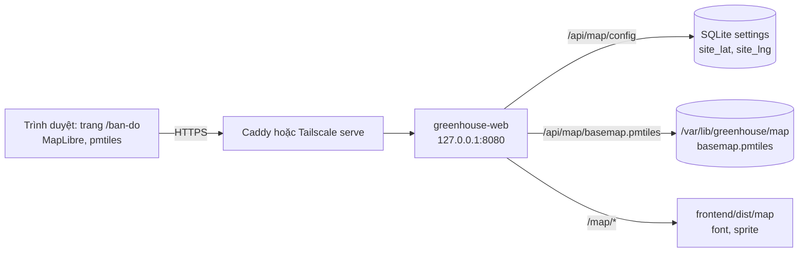

# Spec: Hiển thị vị trí trại trên bản đồ

Nov 5, 2026 · VNArmy

## 1. Mục tiêu và phạm vi

Thêm trang Bản đồ vào web app để người dùng thấy trại nằm ở đâu, kể cả khi trại không có Internet. Vị trí trại là một tọa độ cố định do admin nhập; app không dùng vị trí của thiết bị đang xem.

Tọa độ và file bản đồ của trại chỉ có khi triển khai tại địa điểm. Trước đó, app vẫn build, cài và chạy bình thường, còn trang Bản đồ báo chưa có bản đồ.

| Hạng mục | Trong phạm vi |
| --- | --- |
| Người dùng | `viewer` và `admin` đã đăng nhập, qua LAN hoặc Tailscale |
| Điểm trại | Một tọa độ cố định, admin nhập ở Quản trị · Cài đặt khi triển khai |
| Nền bản đồ | File bản đồ của vùng trại đặt trên Pi, tạo khi triển khai, không gọi dịch vụ ngoài |

Ngoài phạm vi giai đoạn này:

- Vị trí của thiết bị đang xem: chấm GPS, khoảng cách tới trại, xin quyền vị trí.
- Màn HMI: người đứng trước màn vốn đã ở trại.
- Đặt cảm biến lên bản đồ và hiện giá trị đo theo vị trí: `devices` hiện chỉ có `zone` dạng chữ.
- Ảnh vệ tinh, tìm địa chỉ, chỉ đường: đều cần dịch vụ online.
- Lấy tọa độ trại tự động từ GPS: để ngỏ, xem mục 8.

## 2. Hiện trạng và ràng buộc

Phải làm mới cả nền bản đồ lẫn tọa độ trại, vì app chưa có bản đồ và Pi không có GPS. Code phải chạy được khi chưa có dữ liệu của trại, và bước cài dữ liệu đó không được cần Internet trên Pi.

| Điểm kiểm tra | Hiện trạng | Hệ quả |
| --- | --- | --- |
| Bản đồ | `app/frontend/package.json` chỉ có Vue, uPlot, QR. "Bản đồ" trong tài liệu hiện tại là bản đồ thanh ghi Modbus | Phải thêm thư viện và dữ liệu bản đồ |
| Nguồn vị trí trên Pi | BOM và sơ đồ KiCad không có module GPS | Pi không tự biết mình ở đâu; tọa độ trại do admin nhập |
| Thời điểm có dữ liệu | Tọa độ và file bản đồ thật chỉ có khi triển khai tại địa điểm | Phát triển và kiểm thử dùng file mẫu; thiếu dữ liệu là trạng thái bình thường, không phải lỗi |
| `install.sh` | Chạy `apt-get update` và `uv sync`, tức cần mạng | Cài file bản đồ bằng lệnh riêng, không chạy lại `install.sh` (mục 5) |
| Chạy offline | `SPEC.md` mục 10: mọi chức năng chạy khi không có Internet, không tải gì từ CDN | Không dùng tile server online (mục 4) |
| CSP | `CSP` trong `app/greenhouse/web/app.py`: `default-src 'self'`, `connect-src 'self'`, `img-src 'self' data: blob:` | Mọi thứ phải tải từ Pi; worker của MapLibre dùng URL cùng origin (mục 5) |
| Đường Tailscale | `tailscale serve` đi thẳng tới `127.0.0.1:8080`, không qua Caddy | File bản đồ phải do FastAPI phục vụ, không dùng `file_server` của Caddy |
| Tải trang | `router.ts` tải lười từng trang; HMI là entry riêng | Thư viện bản đồ chỉ tải khi mở trang Bản đồ |

## 3. Hành vi trên giao diện

Trang mới `/ban-do`, mục Bản đồ trên thanh điều hướng chính và thanh tab của điện thoại, cho cả `viewer` và `admin`. Khi đã có dữ liệu của trại, mở trang là thấy ngay nền bản đồ, căn giữa vào điểm trại ở zoom 15.

- **Điểm trại**: ghim kèm tên site.
- **Nút Về trại** (góc dưới phải, tối thiểu 44 × 44 px): đưa bản đồ về điểm trại sau khi người dùng kéo đi nơi khác.
- **Dòng thông tin** dưới bản đồ: tên site và tọa độ, kèm nút Sao chép. Tọa độ dùng dấu chấm thập phân, 6 chữ số sau dấu chấm, để dán được vào app bản đồ khác, ví dụ `11.940000, 108.440000`.
- **Ghi công**: `© OpenStreetMap contributors`, link tới [trang bản quyền](https://www.openstreetmap.org/copyright), luôn nhìn thấy.
- **Khung nhìn**: `maxBounds` khóa trong vùng của file bản đồ.

Khi thiếu dữ liệu hoặc không vẽ được bản đồ, trang vẫn dùng được:

| Tình huống | Hành vi |
| --- | --- |
| Chưa có tọa độ và chưa có file (mặc định trước khi triển khai) | Báo "Bản đồ trại sẽ có sau khi lắp đặt tại trại". Admin thấy hai bước: nhập tọa độ ở Cài đặt, rồi cài file |
| Có file, chưa đặt điểm trại | Tâm là tâm của file bản đồ, không có ghim. Admin thấy link tới Cài đặt, viewer thấy "Quản trị viên chưa đặt vị trí trại" |
| Có tọa độ, chưa có file | Hiện tọa độ trại dạng chữ, kèm nút Sao chép. Admin thấy lệnh cài file với khung 1° × 1° quanh trại đã điền sẵn (mục 5) |
| Điểm trại nằm ngoài file bản đồ | Hiện nền, báo "Điểm trại nằm ngoài vùng của file bản đồ" và hiện tọa độ dạng chữ. Admin thấy link tới Cài đặt |
| Trình duyệt không có WebGL | Hiện tọa độ trại dạng chữ, kèm nút Sao chép. [Bắt `GPUInitializationError`](https://maplibre.org/maplibre-gl-js/docs/examples/check-if-webgl-is-supported/) khi tạo bản đồ |

Ở Quản trị · Cài đặt, khối Site và lưu trữ có thêm một ô Tọa độ trại, nhận `vĩ độ, kinh độ` để dán thẳng từ app bản đồ khác. Form báo lỗi ngay tại ô: vĩ độ từ -90 đến 90, kinh độ từ -180 đến 180, phải đủ cả hai. Để trống ô rồi lưu là xóa tọa độ.

## 4. Nền bản đồ chạy offline

Chọn MapLibre GL JS đọc một file PMTiles đặt trên Pi: không cần Internet, không cần tile server, và file cho vùng 110 × 110 km chỉ khoảng 12 MB.

[PMTiles](https://docs.protomaps.com/pmtiles/) là một file duy nhất chứa mọi tile; trình duyệt đọc từng khúc bằng HTTP Range. Pi chỉ trả file, không render, nên không cần thêm dịch vụ nào.

| Phương án | Offline | JS tải thêm (gzip) | Đánh giá |
| --- | --- | --- | --- |
| **MapLibre GL JS + PMTiles (chọn)** | Có | Khoảng 465 KB | Protomaps khuyên dùng cho dự án mới, zoom mượt trên điện thoại. Cần WebGL, phải tự lưu font và sprite |
| Leaflet + protomaps-leaflet + PMTiles | Có | Khoảng 80 KB | Nhẹ, vẽ bằng Canvas. Nhưng [đã vào chế độ bảo trì](https://github.com/protomaps/protomaps-leaflet), tác giả chỉ khuyên dùng cho hệ thống cũ |
| Ảnh bản đồ tĩnh tạo sẵn | Có | Không có | Đơn giản nhất khi chỉ có một điểm. Nhưng không zoom được để xem đường tới trại, và phải tạo lại ảnh khi đổi tọa độ |
| Leaflet + tile của openstreetmap.org | Không | Khoảng 43 KB | [Chính sách OSM](https://operations.osmfoundation.org/policies/tiles/) cấm dùng offline và tải trước tile; trái `SPEC.md` mục 10 |
| Dịch vụ online (Google Maps, Mapbox) | Không | Không đo | Cần Internet, trái `SPEC.md` mục 10 |

Dung lượng JS đo trên file `dist` của gói npm (maplibre-gl 6.16.0, pmtiles 4.5.0, @protomaps/basemaps 5.7.2), chưa tính tree-shaking. Trang khác và HMI không tải phần này. Đường Tailscale không đi qua bộ nén của Caddy, nên lần đầu tải khoảng 1,75 MB rồi lấy từ cache.

Kích thước file bản đồ theo vùng mẫu:

| Vùng mẫu | Zoom 0 đến 14 | Zoom 0 đến 15 |
| --- | --- | --- |
| Đà Lạt, Đức Trọng, khoảng 40 × 40 km | 2,5 MB | 3,9 MB |
| Đồng bằng sông Cửu Long, khoảng 40 × 40 km | 2,6 MB | 4,1 MB |
| Quanh Đà Lạt, 1° × 1°, khoảng 110 × 110 km | 7,1 MB | 12,2 MB |

Số liệu đo ngày 05/11/2026 trên bản build 20261104, bằng cách cộng kích thước tile trong khung từ thư mục của file; chưa chạy `pmtiles extract` thật. Kích thước thật của vùng trại chỉ biết khi triển khai.

Quyết định cho bản đầu:

- **Vùng bản đồ:** khung 1° × 1° quanh trại, zoom 0 đến 15, ngân sách tối đa 50 MB.
- **Nhãn tiếng Việt:** `layers('protomaps', namedFlavor('light'), {lang: 'vi'})`; [Protomaps có hỗ trợ `name:vi`](https://docs.protomaps.com/basemaps/localization).
- **Font và sprite:** tự lưu từ [basemaps-assets](https://docs.protomaps.com/basemaps/maplibre) và đi cùng bản build, không phụ thuộc trại. Chỉ cần Noto Sans Regular, Medium, Italic với 4 khoảng ký tự của tiếng Việt (0-255, 256-511, 768-1023, 7680-7935). Regular đo được 416 KB, nên cả 3 font ước khoảng 1,25 MB.
- **Dữ liệu và giấy phép:** dữ liệu OSM theo ODbL, [bắt buộc ghi công](https://docs.protomaps.com/basemaps/downloads); các thư viện dùng BSD-3-Clause.

Giới hạn vùng còn tránh được việc app hiện bản đồ cấp quốc gia từ dữ liệu cộng đồng. [Nghị định 18/2020/NĐ-CP, Điều 11](https://caselaw.vn/van-ban-phap-luat/352107-nghi-dinh-so-18-2020-nd-cp-ngay-11-02-2020-cua-chinh-phu-ve-xu-phat-vi-pham-hanh-chinh-trong-linh-vuc-do-dac-va-ban-do) có mức phạt khi lưu hành hoặc xuất bản bản đồ liên quan đến chủ quyền mà thể hiện thiếu hoặc sai. Spec chỉ đọc bản gốc của nghị định, chưa có ý kiến pháp lý.

## 5. Thay đổi kỹ thuật

Không cần migration và không đụng tới collector: tọa độ trại nằm trong bảng `settings` sẵn có; phần mới là một router, một trang, một lệnh CLI và một file dữ liệu cài khi triển khai.



Cổng HMI 8081 không có trang Bản đồ, `/api/map` và `/map`.

### Dữ liệu

| Khóa trong `settings` | Giá trị | Mặc định |
| --- | --- | --- |
| `site_lat` | Số thực, -90 đến 90 | `null` |
| `site_lng` | Số thực, -180 đến 180 | `null` |

- Thêm vào `DEFAULT_SETTINGS` (`app/greenhouse/core/db.py`), `SettingsIn` và `SETTING_LABELS` (`app/greenhouse/web/routes/admin_system.py`), `FIELD_NAMES` (`app/greenhouse/web/app.py`). Audit log tự ghi giá trị trước và sau vì đã đi qua `diff`.
- `PUT /api/admin/settings` hiện bỏ qua `null` (`exclude_none=True`), nên không xóa được tọa độ theo đường này. Thêm trường `clear_site_location: bool`, và kiểm tra `site_lat`, `site_lng` phải có đủ cả hai.
- File bản đồ nằm ở `config.data_dir() / "map" / "basemap.pmtiles"`.

### API

| Endpoint | Quyền | Nội dung |
| --- | --- | --- |
| `GET /api/map/config` | viewer | `site` (tên, lat, lng) hoặc `null`; `basemap` (url, size_bytes) hoặc `null` |
| `GET /api/map/basemap.pmtiles` | viewer | File bản đồ, đọc theo Range; 404 nếu chưa cài |
| `PUT /api/admin/settings` | admin | Thêm `site_lat`, `site_lng`, `clear_site_location` |

Yêu cầu với route trả file:

- Kiểm tra file ở mỗi request, không lưu kết quả lúc khởi động, để cài file xong là dùng được ngay, không phải khởi động lại dịch vụ.
- Dùng `FileResponse(path, media_type="application/octet-stream")`. Đã thử bằng TestClient trên Starlette 1.7.0, bản trong `uv.lock`: trả 206, có `Content-Range` và `ETag`.
- Phải ghi rõ kiểu này: [`encode` của Caddy](https://caddyserver.com/docs/caddyfile/directives/encode) nén `text/*`, và phản hồi đã nén không đọc được theo Range. `application/octet-stream` không nằm trong danh sách nén mặc định.
- Tự đặt `Cache-Control: private, max-age=86400`, vì middleware `guard` gán `no-store` cho mọi `/api/` bằng `setdefault`.
- Router mới chỉ đăng ký khi `kind == "main"`, để cổng HMI không có các route này.

### Frontend

- Thêm `maplibre-gl`, `pmtiles`, `@protomaps/basemaps`; chỉ import trong trang mới.
- Trang `pages/MapPage.vue`; phần gọi MapLibre tách ở `components/MapView.vue` và tải lười, nên khi chưa có file bản đồ trình duyệt không tải thư viện. Hàm tách và kiểm tra chuỗi tọa độ ở `lib/geo.ts`, có test vitest như `lib/format.test.ts`.
- Thêm route `/ban-do` vào `router.ts` và `SPA_PATHS` (`app/greenhouse/web/app.py`), thêm mục vào `MAIN_NAV` (`lib/nav.ts`), thêm icon vào `lib/icons.ts`.
- Thêm tab Bản đồ vào `components/AppShell.vue`: thanh tab của điện thoại viết cứng ở đây, không lấy từ `MAIN_NAV`.
- Thêm ô Tọa độ trại vào `pages/admin/SettingsPage.vue`.
- Giữ nguyên CSP: gọi [`setWorkerUrl`](https://maplibre.org/maplibre-gl-js/docs/) với URL worker cùng origin. Vite dev không áp CSP nên phải thử trên bản build ở cổng 8080.
- Font và sprite đặt ở `public/map/`, ra `dist/map/`. Thêm mount `/map` riêng, chỉ cho `kind == "main"`. Tên có ký tự nằm ngoài 4 khoảng đã lưu thì MapLibre tự vẽ bằng font của máy và ghi một cảnh báo, bản đồ không lỗi.

### Phát triển khi chưa có bản đồ thật

- `greenhouse dev` chạy được khi không có file và hiện trạng thái chưa có bản đồ.
- Để thử trang đầy đủ, tạo file mẫu cho vùng Đà Lạt, Đức Trọng (khoảng 4 MB) bằng lệnh `pmtiles extract` ở mục dưới, rồi đặt vào `app/data/map/basemap.pmtiles`. Thư mục `data/` đã được `.gitignore` bỏ qua.
- pytest không cần bản đồ thật: test đọc theo Range và `install-map` dùng file nhỏ tự tạo trong thư mục tạm.

### Triển khai tại trại

Thêm lệnh `greenhouse install-map <file>` vào `app/greenhouse/__main__.py`, không dùng `install.sh`, vì script đó cần mạng trên Pi. Lệnh kiểm tra đầu file đúng PMTiles phiên bản 3 và file đủ dài theo header, chép vào file tạm trong thư mục `map` rồi đổi tên; file sai định dạng hoặc chép chưa xong bị từ chối và file đang dùng giữ nguyên.

```bash
# 1. Đứng tại trại, lấy tọa độ từ app bản đồ trên điện thoại
# 2. Trên web app: Quản trị · Cài đặt, dán tọa độ vào ô Tọa độ trại.
#    Từ đây trang Bản đồ hiện các lệnh dưới với khung đã điền sẵn.

# 3. Trên laptop, cần Internet (4G cũng được)
pmtiles extract https://build.protomaps.com/YYYYMMDD.pmtiles basemap.pmtiles \
  --bbox=MIN_LON,MIN_LAT,MAX_LON,MAX_LAT --maxzoom=15
scp basemap.pmtiles <user>@<địa-chỉ-pi>:/tmp/

# 4. Trên Pi, không cần Internet
sudo -u greenhouse GREENHOUSE_DATA_DIR=/var/lib/greenhouse \
  /opt/greenhouse/app/.venv/bin/greenhouse install-map /tmp/basemap.pmtiles
```

- [`pmtiles extract`](https://docs.protomaps.com/pmtiles/cli) đọc được từ file ở xa. [Bản build hằng ngày](https://docs.protomaps.com/basemaps/downloads) chỉ giữ 1 tuần và URL có thể đổi, nên lấy tên file mới nhất tại thời điểm chạy.
- Trại không có mạng nào, kể cả 4G: tạo file trước khi đi, với khung đủ rộng để chắc chắn chứa trại. Đoán sai khung thì trang báo điểm trại nằm ngoài file (mục 3).
- Nâng cấp mã không làm mất file vì `/var/lib/greenhouse` được giữ nguyên.
- Không commit file vào git và không để trong `frontend/dist`, vì mỗi trại một vùng. Backup không cần chứa file này vì tạo lại được.
- `Caddyfile` và `chromium-policy.json` giữ nguyên.

## 6. Bảo mật

App không thu thập vị trí của người dùng; dữ liệu mới duy nhất là tọa độ trại, chỉ người đã đăng nhập mới đọc được.

| Dữ liệu | Nơi lưu | Ai xem được |
| --- | --- | --- |
| Tọa độ trại | Bảng `settings`, audit log, backup | `viewer` và `admin` đã đăng nhập |
| File bản đồ | `/var/lib/greenhouse/map` | `viewer` và `admin` đã đăng nhập; dữ liệu công khai, nhưng khung của file lộ vùng đặt trại |

- `GET /api/auth/site` là endpoint công khai của trang đăng nhập: không được thêm tọa độ trại vào đây.
- Yêu cầu đọc bản đồ chỉ đi tới Pi; `connect-src 'self'` của CSP chặn gọi dịch vụ ngoài, kể cả khi code có lỗi.
- Code không gọi `navigator.geolocation`, nên trình duyệt không hỏi quyền vị trí.

## 7. Nghiệm thu và ước lượng

Phần lập trình tốn khoảng 4,5 ngày công, nghiệm thu bằng file mẫu; bước tại trại khoảng 0,5 ngày, tính vào đợt triển khai. Đây là ước lượng lúc viết spec, chưa qua người sẽ làm.

| Việc | Ngày công |
| --- | --- |
| Tạo file mẫu, thêm font và sprite, chạy thử MapLibre dưới CSP hiện tại | 0,5 |
| Backend: cài đặt tọa độ, `/api/map/*`, `greenhouse install-map`, pytest | 1 |
| Trang Bản đồ: nền, điểm trại, nút, điều hướng, các trạng thái thiếu dữ liệu | 1,5 |
| Ô Tọa độ trại ở Quản trị · Cài đặt, `lib/geo.ts`, vitest | 0,5 |
| README, cập nhật `SPEC.md` và hướng dẫn sử dụng | 0,5 |
| Thử trên máy thật với file mẫu: Android, iPhone, Tailscale, mất Internet | 0,5 |
| **Tổng** | **4,5** |

Nghiệm thu trước khi triển khai, với file mẫu:

- [x] Bản cài mới, chưa có tọa độ và file: trang báo "Bản đồ trại sẽ có sau khi lắp đặt tại trại", không có lỗi JS.
- [x] Có tọa độ nhưng chưa có file, hoặc trình duyệt tắt WebGL: hiện tọa độ dạng chữ, không có lỗi JS.
- [x] Có file nhưng chưa đặt điểm trại: viewer thấy thông báo, admin thấy link tới Cài đặt.
- [ ] `greenhouse install-map` chạy được khi Pi không có Internet; bản đồ hiện ngay, không phải khởi động lại dịch vụ. File sai định dạng bị từ chối, file đang dùng giữ nguyên.
- [ ] Admin dán tọa độ mẫu ở Cài đặt, rồi mở `/ban-do` trên Android Chrome và iPhone Safari: ghim đúng chỗ so với một app bản đồ khác, zoom được, có tên site và ghi công OSM.
- [ ] Rút Internet của router, LAN vẫn chạy: trang mở được, nhãn tiếng Việt có dấu hiện đúng, DevTools không có yêu cầu nào ra ngoài Pi.
- [ ] Qua `https://<tên-pi>.<tailnet>.ts.net`: bản đồ hiện đủ, không đi qua Caddy.
- [ ] Có session, gửi `Range: bytes=0-16383` qua Caddy và qua cổng 8080: cả hai trả 206, không có `Content-Encoding`. Không có session: trả 401.
- [x] Bản build trên cổng 8080: Console không có lỗi CSP, CSP không đổi so với hiện tại.
- [x] Điểm trại nằm ngoài file bản đồ: hiện thông báo và tọa độ dạng chữ.
- [x] Đặt, sửa, xóa tọa độ: audit log có giá trị trước và sau; vĩ độ 91 hoặc thiếu kinh độ bị chặn ngay tại ô.
- [x] Cổng 8081: `/api/map/config`, `/api/map/basemap.pmtiles`, `/map/` đều trả 404; `hmi.html` không tải MapLibre.
- [x] `GET /api/auth/site` không chứa tọa độ; `GET /api/map/config` không có session trả 401.
- [x] Trình duyệt không hỏi quyền vị trí trên bất kỳ trang nào.
- [ ] Trang Tổng quan không tải thêm JS so với trước; trang Bản đồ hiện nền dưới 3 giây trong LAN.

Nghiệm thu khi triển khai tại trại, với file thật:

- [ ] Đứng tại trại: ghim trùng với vị trí thật so với app bản đồ trên điện thoại.
- [ ] File thật không vượt 50 MB; ghi lại kích thước.
- [ ] Ngắt Internet của trại: bản đồ vẫn hiện, nhãn tiếng Việt có dấu hiện đúng.
- [ ] Ghi lại mức chi tiết của OSM ở vùng trại, và báo lại nếu quá thưa (mục 8).

## 8. Giả định và câu hỏi mở

Phạm vi đã chốt và không câu hỏi nào chặn việc bắt đầu, vì tọa độ và bản đồ thật chỉ cần khi triển khai.

Câu hỏi mở:

- [x] "Địa điểm hiện tại" là vị trí trại, không phải vị trí của thiết bị đang xem (chốt 05/11/2026).
- [x] Tọa độ trại và file bản đồ thật có khi triển khai tại địa điểm (chốt 05/11/2026).
- [x] Tọa độ trại nhập tay, để ngỏ phần lấy từ GPS nếu có; không lấy theo IP (chốt 05/11/2026).
- [ ] OSM ở vùng trại có đủ chi tiết không? Chỉ đánh giá được khi biết vị trí, nên có thể phát hiện muộn. Nếu quá thưa, ghim và tọa độ vẫn đúng, nhưng phải bàn lại nguồn nền vì ảnh vệ tinh cần dịch vụ online.
- [ ] Có cần bản đồ trên màn HMI không? Spec mặc định là không. Nếu cần, phải thử WebGL của Chromium trên Pi và giới hạn `MemoryMax=1G`.
- [ ] Có cần ý kiến pháp lý về việc dùng dữ liệu OSM trong app nội bộ không (mục 4)?

Giả định:

- 1 Pi ứng với 1 trại và 1 điểm trại (`SPEC.md` mục 12).
- Người triển khai có laptop, truy cập SSH vào Pi và có Internet tại trại, kể cả 4G; nếu không có thì tạo file trước khi đi (mục 5).
- Khi spec được duyệt, các mục liên quan của `SPEC.md` được cập nhật theo tài liệu này.

### Để ngỏ: lấy tọa độ từ GPS

Đợt này chưa có code cho GPS. Khi có nguồn GPS, phần thêm vào giữ các nguyên tắc sau, nên không phải đổi dữ liệu hay API đọc:

- Ô Tọa độ trại vẫn là đường ghi duy nhất. Nguồn GPS chỉ điền sẵn ô này; admin xem lại rồi bấm Lưu, không tự lưu.
- Nút lấy từ GPS chỉ hiện khi có nguồn dùng được.

| Nguồn | Phải làm thêm | Điều cần kiểm chứng |
| --- | --- | --- |
| GPS của điện thoại người đứng tại trại | Nút gọi `navigator.geolocation` ở trình duyệt, không cần backend | Trình duyệt chỉ cho dùng trên kết nối an toàn. Chưa biết điện thoại chưa cài CA của Caddy, bấm bỏ qua cảnh báo chứng chỉ, có lấy được vị trí không; phải thử trên máy thật |
| Module GPS gắn vào Pi | Phần cứng, cổng đọc, endpoint trả vị trí hiện tại | BOM và sơ đồ KiCad chưa có module |

`chromium-policy.json` chặn vị trí chỉ trên màn kiosk, và app chưa có header `Permissions-Policy`, nên hiện không có gì phải gỡ. Thiết kế tham khảo cho nguồn GPS điện thoại nằm ở mục 1, 3 và 4 của [mockup](mockup-ban-do.html).

## Nguồn

Các trang dưới đây được truy cập ngày 05/11/2026.

- [MapLibre GL JS](https://maplibre.org/maplibre-gl-js/docs/): CSP, `setWorkerUrl`. [Ví dụ kiểm tra WebGL](https://maplibre.org/maplibre-gl-js/docs/examples/check-if-webgl-is-supported/): `GPUInitializationError`.
- [PMTiles](https://docs.protomaps.com/pmtiles/), [PMTiles CLI](https://docs.protomaps.com/pmtiles/cli), [PMTiles với MapLibre](https://docs.protomaps.com/pmtiles/maplibre): định dạng file, lệnh `extract`, cách đăng ký protocol.
- [Protomaps Downloads](https://docs.protomaps.com/basemaps/downloads), [Basemaps cho MapLibre](https://docs.protomaps.com/basemaps/maplibre), [Localization](https://docs.protomaps.com/basemaps/localization): bản build, giấy phép, font và sprite, nhãn tiếng Việt.
- [protomaps-leaflet](https://github.com/protomaps/protomaps-leaflet), [PMTiles với Leaflet](https://docs.protomaps.com/pmtiles/leaflet): chế độ bảo trì.
- [Chính sách tile của OSM](https://operations.osmfoundation.org/policies/tiles/), [Bản quyền OSM](https://www.openstreetmap.org/copyright): cấm offline, ghi công, ODbL.
- [Caddy `encode`](https://caddyserver.com/docs/caddyfile/directives/encode): danh sách nén mặc định, Range.
- [Nghị định 18/2020/NĐ-CP](https://caselaw.vn/van-ban-phap-luat/352107-nghi-dinh-so-18-2020-nd-cp-ngay-11-02-2020-cua-chinh-phu-ve-xu-phat-vi-pham-hanh-chinh-trong-linh-vuc-do-dac-va-ban-do): Điều 11, bản gốc.
